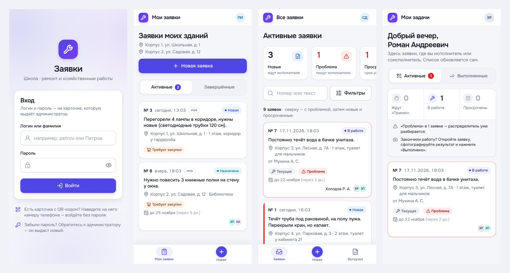
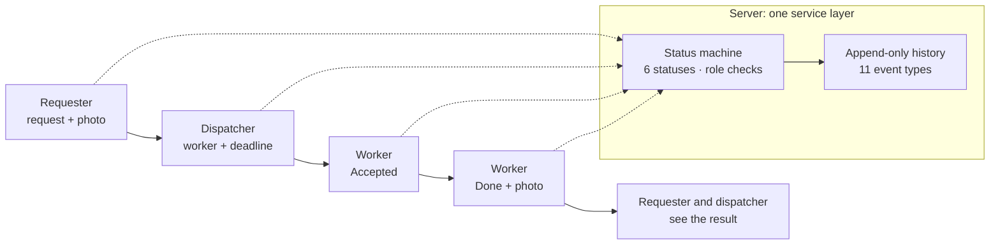
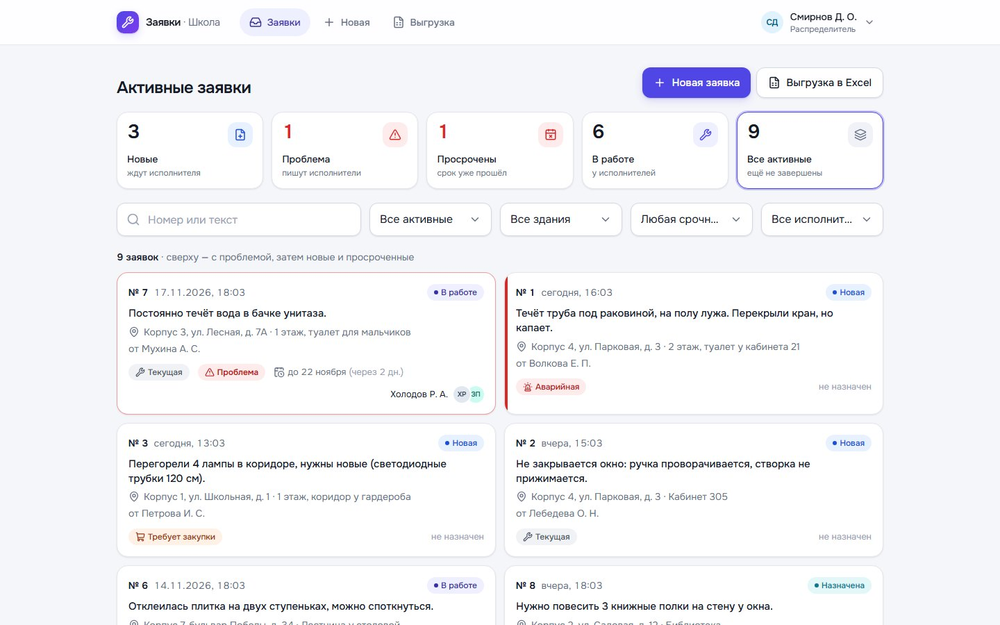

# School Repair Desk

**A mobile-first repair-request system for a public school with eight buildings, from a handwritten process sketch to production in 48 hours: a server-enforced request lifecycle, QR-card login for every staff member, role screens for requesters, the dispatcher and workers, and a full event history. I owned scope, architecture and acceptance.**



*All names and addresses in this repository and its screenshots are fictional demo data.*

Across eight buildings, a broken radiator used to travel by phone call and memory: nobody could say later who took the job, when, or whether it was done. The school drew the workflow it wanted on paper and needed it on staff phones fast.

| | |
|---|---|
| **Timeline** | Client's answers at 12:51, working local MVP at 14:52, redesign and production deploy by noon the next day |
| **At handover** | 20 accounts (6 requesters, 1 dispatcher, 12 workers, 1 admin), 8 buildings, printable QR access cards, a user guide |
| **Quality** | 59 service-layer tests on in-memory PostgreSQL (PGlite) in a tsc -> lint -> test -> build chain; Puppeteer smoke tests against production after deploy (not included: they target the live host) |
| **Stack** | Next.js 16 (Server Actions), React 19, Tailwind v4, Drizzle ORM, PostgreSQL 16, Docker Compose, Traefik |
| **Size** | ~155 TypeScript files, ~18,600 lines |

---

## The workflow



- **Requesters** file a request for their own buildings, with a photo.
- **The dispatcher** sees everything, assigns a worker (and co-workers) and a deadline, and is alerted to problems and overdue jobs.
- **Workers** tap "Accepted", then "Done" with a photo of the result, or raise a problem.
- **The admin** manages people and buildings, prints QR access cards and exports everything to Excel.



## Engineering decisions

- **Permissions live on the server, not in the UI.** Every transition across the 6 statuses goes through one service layer that checks the actor's role and relation to the request, and writes an append-only history entry (11 event types). The UI only renders what the server allows.
- **Login built for phones and messengers.** Staff sign in by scanning a personal QR code or opening a personal link, so nobody types credentials on a phone. Those links complete only via POST, so a chat app's link preview cannot open a session. Passwords are hashed with scrypt, login is rate-limited, and the login field accepts either the login or a surname typed in Cyrillic.
- **Production on a crowded box.** The target was a 1-CPU, 2 GB VPS already running another client's live service. The app ships as a prebuilt standalone image, containers are capped at 320 MB and 192 MB, routing reuses the existing Traefik, and the neighbouring stack is untouched.
- **Reuse over rewrite.** Auth, crypto, the UI kit and the database layer came from an earlier project of mine, which is a large part of why the first MVP took two hours.
- **Owning the miss.** The admin password reached production with an invisible `\r` from a CRLF CSV file. It was caught by the post-deploy check, fixed, and all 20 credentials were then re-verified end to end.

## Delivery as an agent pipeline

1. Five scout agents explored the client's answers and the reusable code in parallel.
2. Their findings became [`SPEC.md`](SPEC.md): roles, visibility rules, statuses, screens and deployment, written for AI agents to execute.
3. One agent built the core: schema, migrations, auth and the service layer with tests.
4. Three agents built the requester, dispatcher and worker screens in parallel against that core.
5. A redesign pass against [`DESIGN.md`](DESIGN.md), then deploy, smoke tests and the user guide.

My scope calls kept it to two days: no notifications in v1, no polishing before the workflow worked, and every account created up front so handover was a stack of printed cards.

## Run it locally

```bash
npm install
npm run db:setup     # in-process PGlite database, fictional roster, demo requests in every status
npm run dev          # http://localhost:3000
npm test             # 59 tests
```

Demo logins come from [`data/roster.json`](data/roster.json) and are printed by `db:setup`, for example `smirnov` (dispatcher), `petrova` (requester) and `kholodov` (worker), all with the password `demo-pass-2026`. Production uses PostgreSQL through `docker-compose.yml`; see `.env.example`.

## Notes

- The interface, the spec and the design brief are in Russian, as the users are.
- The production roster, credentials, handover files and server details are not part of this repository; the roster here is invented.
- Code was written AI-first with Claude Code; requirements, scope, architecture, acceptance and handover are mine.

## License

MIT
